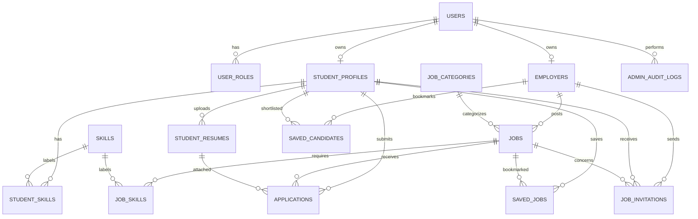

# Thiết kế cơ sở dữ liệu

Thiết kế quan hệ phù hợp triển khai bằng Django ORM và MySQL. Tên bảng dưới đây là tên logic; kiểu dữ liệu chi tiết sẽ theo model/framework và cần migration quản lý.

## 1. Bảng và khóa

| Bảng | Trường chính | Ràng buộc quan trọng |
|---|---|---|
| `users` | `id`, `email`, `password_hash`, `is_active`, `created_at` | email duy nhất; mật khẩu chỉ lưu dạng băm |
| `user_roles` | `id`, `user_id`, `role` | unique (`user_id`, `role`); role thuộc tập cho phép |
| `student_profiles` | `id`, `user_id`, `school`, `major`, `location`, `salary_min`, `salary_max`, `available_time`, `is_searchable` | `user_id` unique; `is_searchable` mặc định false |
| `skills` | `id`, `name`, `normalized_name` | `normalized_name` duy nhất |
| `student_skills` | `id`, `student_profile_id`, `skill_id`, `proficiency`, `years_experience` | unique (`student_profile_id`, `skill_id`) |
| `student_resumes` | `id`, `student_profile_id`, `storage_key`, `original_name`, `content_type`, `size_bytes`, `is_active`, `created_at` | CV thuộc hồ sơ; tệp lưu riêng tư, không dùng URL công khai |
| `employers` | `id`, `user_id`, `organization_name`, `description`, `website`, `verified_at` | `user_id` unique |
| `job_categories` | `id`, `name`, `parent_id`, `is_active` | tên chuẩn hóa duy nhất; `parent_id` tự tham chiếu tùy chọn |
| `jobs` | `id`, `employer_id`, `category_id`, `title`, `description`, `location`, `work_mode`, `salary_min`, `salary_max`, `deadline`, `status`, `created_at` | trạng thái hợp lệ; chỉ chủ sở hữu cập nhật; index trạng thái/hạn/danh mục |
| `job_skills` | `id`, `job_id`, `skill_id`, `required_level`, `is_required` | unique (`job_id`, `skill_id`) |
| `applications` | `id`, `student_profile_id`, `job_id`, `resume_id`, `cover_letter`, `status`, `submitted_at`, `updated_at` | unique (`student_profile_id`, `job_id`); index (`job_id`, `status`) |
| `saved_jobs` | `id`, `student_profile_id`, `job_id`, `created_at` | unique (`student_profile_id`, `job_id`) |
| `job_invitations` | `id`, `employer_id`, `student_profile_id`, `job_id`, `message`, `status`, `sent_at`, `responded_at` | index người nhận/trạng thái; chặn lời mời pending trùng theo quy tắc nghiệp vụ |
| `saved_candidates` | `id`, `employer_id`, `student_profile_id`, `created_at` | unique (`employer_id`, `student_profile_id`) |
| `admin_audit_logs` | `id`, `admin_user_id`, `action`, `object_type`, `object_id`, `details`, `created_at` | chỉ admin ghi/đọc; tránh ghi dữ liệu CV nhạy cảm vào `details` |

Các bảng `reports`, `notifications`, `cv_analyses` có thể bổ sung khi triển khai đầy đủ quản trị/thông báo/phân tích CV.

## 2. Quan hệ

## 3. Xóa dữ liệu và toàn vẹn

- Dùng khóa ngoại thực và xác định chính sách xóa. Hồ sơ/tin có lịch sử ứng tuyển nên ưu tiên lưu trữ/ẩn (soft delete hoặc trạng thái) thay vì xóa dây chuyền lịch sử.
- Xóa CV phải kiểm tra tham chiếu từ hồ sơ ứng tuyển; nếu đã được dùng, có thể vô hiệu hóa tệp và giữ bản ghi lịch sử theo chính sách lưu trữ.
- Ứng tuyển và lời mời dùng khóa ngoại rõ ràng tới hồ sơ sinh viên, nhà tuyển dụng và tin tương ứng.
- Kiểm tra trạng thái tin và quyền sở hữu trong giao dịch nghiệp vụ lúc tạo ứng tuyển/lời mời; ràng buộc DB chống trùng là lớp bảo vệ cuối.
- Tiền lương lưu số nguyên theo đơn vị tiền tệ thống nhất, có thể null nếu không công khai; kiểm tra min không lớn hơn max.
- Mọi mốc thời gian lưu nhất quán (UTC ở DB); hiển thị theo múi giờ cấu hình.
- Không dùng email hoặc tên người dùng làm khóa ngoại thay cho ID ổn định.

## 4. Chỉ mục đề xuất

- `jobs(status, deadline)`, `jobs(category_id, status)`, `jobs(location, work_mode)`.
- `applications(job_id, status)` và unique (`student_profile_id`, `job_id`).
- `student_profiles(is_searchable, location, major)`.
- Các unique pair trong `student_skills`, `job_skills`, `saved_jobs`, `saved_candidates`.
- Bổ sung full-text index cho tiêu đề/mô tả sau khi xác định phiên bản MySQL và cách tìm kiếm.
